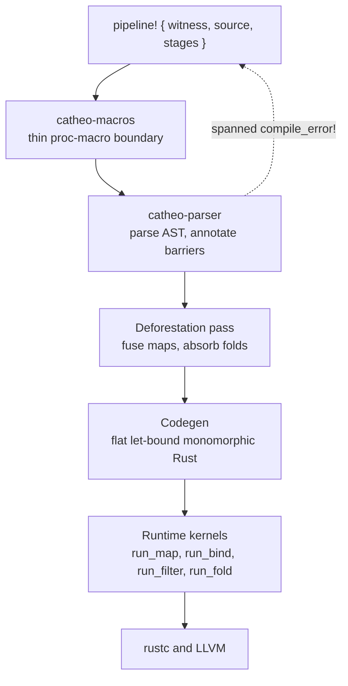

<div align="center">
  
  <p>
    <strong>Categorical pipelines for Rust that compile to flat, fused imperative loops</strong><br/>
    Write a pipeline as category theory — functors, monads, Kleisli chains — and the
    <code>pipeline!</code> macro lowers it to let-bound monomorphic code before rustc ever
    sees it. The categorical algebra stays in witness types and macro validation; it is
    absent from the generated binary. Built for Rust developers who want composable
    <code>Option</code>/<code>Result</code> chains and data pipelines without boxing,
    trait objects, or per-stage intermediates: the v0.2 gates pin the output at parity
    with idiomatic iterator chains, with zero intermediate containers on the fused path.
  </p>
  <p>
    <a href="https://github.com/elcoosp/catheo/actions/workflows/ci.yml"></a>
    <a href="https://github.com/elcoosp/catheo/blob/main/Cargo.toml"></a>
    <a href="https://github.com/elcoosp/catheo/blob/main/Cargo.toml"></a>
    <a href="https://github.com/elcoosp/catheo/blob/main/Cargo.toml"></a>
    <a href="https://github.com/elcoosp/catheo/blob/main/LICENSE"></a>
  </p>
</div>

<p align="center">
  <a href="#quickstart">Quickstart</a> • <a href="#features">Features</a> • <a href="#how-it-works">How it works</a> • <a href="#usage">Usage</a> • <a href="#status">Status</a> • <a href="#learn-more">Learn more</a>
</p>

## Quickstart

Prerequisite: Rust 1.99 or newer (edition 2024; the workspace MSRV is `rust-version = "1.99"`).

```console
cargo add catheo --git https://github.com/elcoosp/catheo
```

The crates are not published on crates.io yet, so the install resolves from the git repository. The `pipeline!` macro is re-exported from `catheo` itself, so this one dependency is all you need (`catheo-macros` arrives transitively). Put this in `main.rs`:

```rust
use catheo::{pipeline, VecWitness};

fn main() {
    let input = vec![1_i32, 2, 3, 4];
    let total: usize = pipeline! {
        witness: VecWitness,
        source: input,
        map: |x| x * 2,
        map: |x| x.to_string(),
        fold: (0_usize, |acc, s| acc + s.len()),
    };
    assert_eq!(total, 4);
}
```

The two `map` stages and the `fold` fuse into a single pass; no intermediate `Vec` is built between source and eliminator.

## Features

- **Fusion by construction.** A linear-time deforestation pass (`crates/catheo-parser/src/fuse.rs`) fuses adjacent `map`s into non-observing `bind`s and absorbs pure `fold`s, so the flagship `map → map → fold` shape runs as one loop with no intermediate containers.
- **Deterministic, not anecdotal, performance.** `catheo-counting-alloc` is a thread-local counting allocator used by `crates/catheo/tests/v02_gates.rs` to pin three-way value agreement, allocation profiles, and fused-emission shape lockstep as plain `cargo test` gates — no wall-clock flakiness in CI.
- **Laws checked, errors spanned.** Functor identity/composition and monad left/right identity/associativity are swept per witness in `crates/catheo/tests/categorical_laws.rs`; a 28-case trybuild suite (7 compile-pass, 21 compile-fail) in `crates/catheo/tests/ui/` pins every rejection to the offending user token, not macro internals.
- **Kleisli chains and monoid folds.** `kleisli: (f, g, …)` desugars the `>=>` chain to nested binds and still fuses across the boundary; `fold_map:` eliminates into any `Monoid` — the 12 integer types, `f32`/`f64`, `()`, `String`, `Vec<T>`, `Option<T>`, and tuples (impls in `crates/catheo/src/categorical.rs`).
- **Witnesses for containers you already use.** `VecWitness`, `OptionWitness`, and `ResultWitness<E>` implement the GAT-based `HKT` layer (`crates/catheo/src/hkt.rs`), or skip the witness entirely: `source: xs as Vec<i32>` derives it from the ascription.
- **Escape hatches and an oracle.** `bind!: force` and `bind!: materialize` override the conservative fusion analysis in either direction, and `pipeline_unfused!` expands the same grammar without fusion — expanding a suspect pipeline through both macros isolates any mis-rewrite to the fusion pass.

## How it works

A pipeline is a token stream. `catheo-macros` is a thin proc-macro boundary; all real work happens in `catheo-parser`, which parses the stage grammar into a `Pipeline` AST, annotates fusion barriers at parse time, runs the deforestation pass, and emits flat, let-bound Rust that calls the runtime kernels in `crates/catheo` (witness traits like `CategoricalFunctor::run_map` and `CategoricalMonad::run_bind`). Parse errors become spanned `compile_error!` diagnostics at the offending token.



## Usage

Stages read top to bottom. Without a terminal, the pipeline evaluates to the last stage's container.

```rust
use catheo::{pipeline, VecWitness};

let input = vec![1_i32, 2, 3, 4];
let total: i64 = pipeline! {
    witness: VecWitness,
    source: input,
    map: |x: i32| x * 10,
    filter: |x: &i32| *x % 20 == 0,
    fold: (0_i64, |acc: i64, x: i32| acc + i64::from(x)),
};
assert_eq!(total, 60);
```

Kleisli composition and monoid elimination (both v0.2):

```rust
use catheo::{pipeline, ResultWitness, VecWitness};

// `f >=> g` over Result: an Err short-circuits the chain.
let outcome: Result<i32, String> = pipeline! {
    witness: ResultWitness::<String>,
    source: Ok::<i32, String>(5),
    kleisli: (
        |x: i32| x.checked_mul(2).ok_or_else(|| "overflow".to_string()),
        |x: i32| x.checked_add(1).ok_or_else(|| "overflow".to_string()),
    ),
};
assert_eq!(outcome, Ok(11_i32));

// No `init`: the accumulator starts at the metric's monoid identity.
let words = vec!["alpha".to_string(), "be".to_string(), "gamma".to_string()];
let letters: usize = pipeline! {
    witness: VecWitness,
    source: words,
    fold_map: |w: String| w.len(),
};
assert_eq!(letters, 12); // 5 + 2 + 5
```

Escape hatches, for when the conservative structural-observer analysis gets it wrong:

```rust
use catheo::{pipeline, VecWitness};

let rows: Vec<Vec<i32>> = vec![vec![1, 2], vec![3, 4]];
let total: i64 = pipeline! {
    witness: VecWitness,
    source: rows,
    bind!: force |row: Vec<i32>| row.iter().sum(),
    fold: (0_i64, |acc, x| acc + i64::from(x)),
};
assert_eq!(total, 20);
```

> [!TIP]
> `bind!: force` skips the fusion safety analysis. Use it only when the closure provably ignores container shape (`.len`, `.iter`, `Some`/`None`, `Ok`/`Err`, and friends would normally block fusion); `bind!: materialize` is the opposite direction, forcing an intermediate container.

The grammar at a glance:

| Entry | Role |
|---|---|
| `map:` | per-element transform; the fusion target |
| `bind:` | monadic stage — flattens on `Vec`, `and_then` on `Option`/`Result` |
| `filter:` | predicate; an absolute fusion barrier by design |
| `kleisli: (f, g, …)` | `>=>` chain desugared to nested binds at parse time |
| `fold: (init, f)` | universal eliminator to a single value |
| `fold_map:` | monoid eliminator; accumulator starts at the identity |
| `collect` | terminal: evaluate to the resulting container |
| `map!: force` / `bind!: force` / `bind!: materialize` | escape hatches over the fusion analysis |

Witnesses are `VecWitness`, `OptionWitness`, and `ResultWitness<E>` — or none at all when the source carries a type ascription. Outside pipelines, `catheo::kleisli(witness, f, g)` composes two arrows associatively, and the runtime layer exposes `Monoid`, `CategoricalFoldMap::run_fold_map`, `CategoricalPointed::run_pure`, and `CategoricalMonad::run_join` directly. The full layer model, fusion rules, and kernel coverage table are in [docs/ARCHITECTURE.md](docs/ARCHITECTURE.md).

## Status

> [!NOTE]
> Catheo is at v0.2.0, an early 0.x release: the design is benchmark-gated and the API may still change. CI (`.github/workflows/ci.yml`) runs rustfmt, clippy pedantic at deny with a zero allow-list, and the full test suite on ubuntu-latest; the test job pins rustc 1.99.1 because trybuild snapshots compare diagnostics byte-for-byte. The workspace MSRV is 1.99 (edition 2024). Linux is the platform CI exercises; the shipped crates are pure Rust with `unsafe_code` forbidden — the one exception is the dev-only counting allocator, which no shipped artifact links.

Releases are cut by pushing a `v*.*.*` tag; git-cliff renders the changelog and `release.yml` publishes the GitHub release.

To verify a checkout locally:

```sh
cargo fmt --all -- --check
cargo clippy --workspace --all-targets -- -D warnings
cargo test --workspace
cargo bench --bench abc
```

## Learn more

- [docs/ARCHITECTURE.md](docs/ARCHITECTURE.md) — the full design: architectural layers, the fusion rules and their limits, the benchmark protocol, and the roadmap.
- [CHANGELOG.md](CHANGELOG.md) — release history, generated by git-cliff from Conventional Commits.
